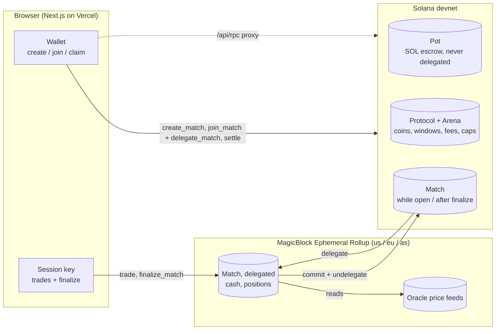

# Rug Royale v2: live-price trading duels on MagicBlock

**Trading as a competitive sport.** Two players, the same $10,000 virtual bankroll, the same 10 live Solana coins, 5 to 60 minutes. The higher portfolio at the end takes the pot. Trades are instant and gasless on a MagicBlock Ephemeral Rollup; the money never leaves Solana.

Built for MagicBlock Blitz (Entertainment Finance). Live on devnet: [rug-royale-seven.vercel.app/arena](https://rug-royale-seven.vercel.app/arena).

| | |
| --- | --- |
| **Program (devnet)** | [`2hcR5rib7mNkcFHnPEfjhH1yJdNsPmK6SVkU3dDjD9Cr`](https://explorer.solana.com/address/2hcR5rib7mNkcFHnPEfjhH1yJdNsPmK6SVkU3dDjD9Cr?cluster=devnet) (`programs/rug_royale_v2`) |
| **Stack** | Anchor 1.1.2, `ephemeral-rollups-sdk` 0.17, MagicBlock Pricing Oracle (Pyth Lazer), Next.js 16 |
| **Tests** | 159 v2 LiteSVM test cases (run against MagicBlock's real Delegation Program), Rust math vectors shared with the TS SDK, a full-duel devnet smoke test through the ER |

## How a duel works

1. **Create.** The creator picks an arena, a window (5 min, 15 min, 1 h; 30/60 s in the test arena) and an entry (0.01 to 1 SOL, or free), and escrows it in a program-owned `Pot` on Solana. The app picks the creator's lowest-ping MagicBlock region (US, EU or Asia) and pins the duel to it.
2. **Join.** The opponent escrows the same entry. **One wallet approval** joins the duel and delegates the `Match` account to the pinned Ephemeral Rollup. Each player's tab registers a fresh **session key** in its seat.
3. **Trade.** After a short start delay, both players buy coins or sell back to cash at the **live oracle price** minus a 0.1% virtual fee. Trades are signed by the session key and sent straight to the rollup: **no popups, no fees, about 80 to 300 ms each**. A live PnL race bar shows who is ahead.
4. **Finalize.** At the end of the window, `finalize_match` marks both portfolios at the first fresh price published in `[end, end + 5 s]`, then commits and undelegates `Match` back to Solana. A player's tab does this automatically with its session key (an unfunded key can pay for it on the ER); an optional crank does the same.
5. **Claim.** The winner presses **Claim winnings**: `settle` on Solana pays the pot minus a 5% rake (no rake on free duels) from the `Pot`. Ties split the pot. The result card is shareable and offers a one-tap rematch.

If a duel can never be finalized (for example the rollup is down), `refund_stale` returns both entries on Solana after 24 h, without the rollup.

## What MagicBlock makes possible

| MagicBlock piece | What it does here | Why the game needs it |
| --- | --- | --- |
| **Ephemeral Rollup** | Holds the delegated `Match` (cash, positions, trade count) during the window | 20 to 50 trades per player would cost more in base-layer fees than a small entry, and each would need a wallet popup |
| **Delegation + commit/undelegate** | `join_match` + `delegate_match` in one transaction; `finalize_match` commits and undelegates | The game state goes to the rollup only while it's live; payouts read the committed result on Solana |
| **Pricing Oracle** (Pyth Lazer feeds) | Live prices for SOL, JUP, JTO, RAY, PYTH, BONK, WIF, POPCAT, PENGU, TRUMP inside the rollup | Trades and final marks use real prices, read on-chain by the program |
| **Regional validators** | US / EU / Asia, chosen by measured ping; shown in the lobby | Lower latency for the players |
| **Gasless transactions** | Session keys hold no SOL | No funding step, nothing to lose if a key leaks: it can only `trade` in one match while its window is open |

## Architecture



**Two accounts per duel.** `Pot` (money) stays on Solana and is never delegated; `Match` (game state) is delegated to the rollup from join until finalize. Everything the money path needs (players, entry, end time) is copied into `Pot` at join, so cancel, settle and the 24 h refund work from Solana alone.

**Contest layer and mode layer.** Entries, escrow, the clock, rake, settlement and recovery are written once. The duel is the first mode (`Arena.mode`); future modes reuse the same contest layer.

### Instructions (14)

| Layer | Instructions |
| --- | --- |
| Admin | `init_protocol`, `update_protocol`, `create_arena`, `update_arena` |
| Contest (base) | `create_match`, `sponsor_match`, `join_match`, `delegate_match`, `cancel_match`, `settle`, `refund_stale`, `close_match` |
| Mode (ER) | `trade`, `finalize_match` |

### Safety

- SOL only moves on Solana, from a program-owned `Pot`, to addresses fixed on-chain.
- Every action after create is permissionless and idempotent; no step depends on a server.
- Session keys are checked per seat and can only `trade` in their own match while its window is open. `finalize_match` is permissionless, so any key (the session key included) can pay for it.
- Admin caps (max entry, pause, rake) are adjustable without a redeploy so the protocol can go from free play to small stakes behind a multisig.

## Roadmap: a multiplayer Entertainment Finance platform

The duel proves the contest layer. Next modes on the same layer: **Battle Royale** (N players, lowest portfolio eliminated every few minutes), **team modes** (2v2, 5v5), **partner arenas** with sponsored prize pools, **agent vs human**, shooter-style variants (one life, forced coin rotation, king of the hill), **hidden positions on a Private Ephemeral Rollup**, and fully on-chain settlement with MagicBlock's native ER crank + Magic Actions. Then a mainnet free-play beta, and real-money entries after an external audit.

## Run it

```bash
pnpm install
pnpm v2:programs && pnpm test            # build + LiteSVM suites (v1 and v2)
pnpm v2:smoke-duel                          # full duel on devnet through the US ER
pnpm v2:crank                               # optional: finalize + settle + refund + close bot
pnpm --filter @rug-royale/app dev           # app at localhost:3000/arena
```
